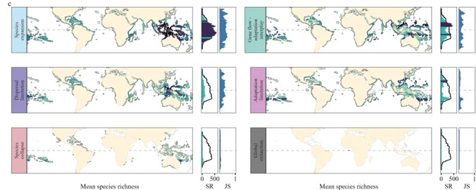
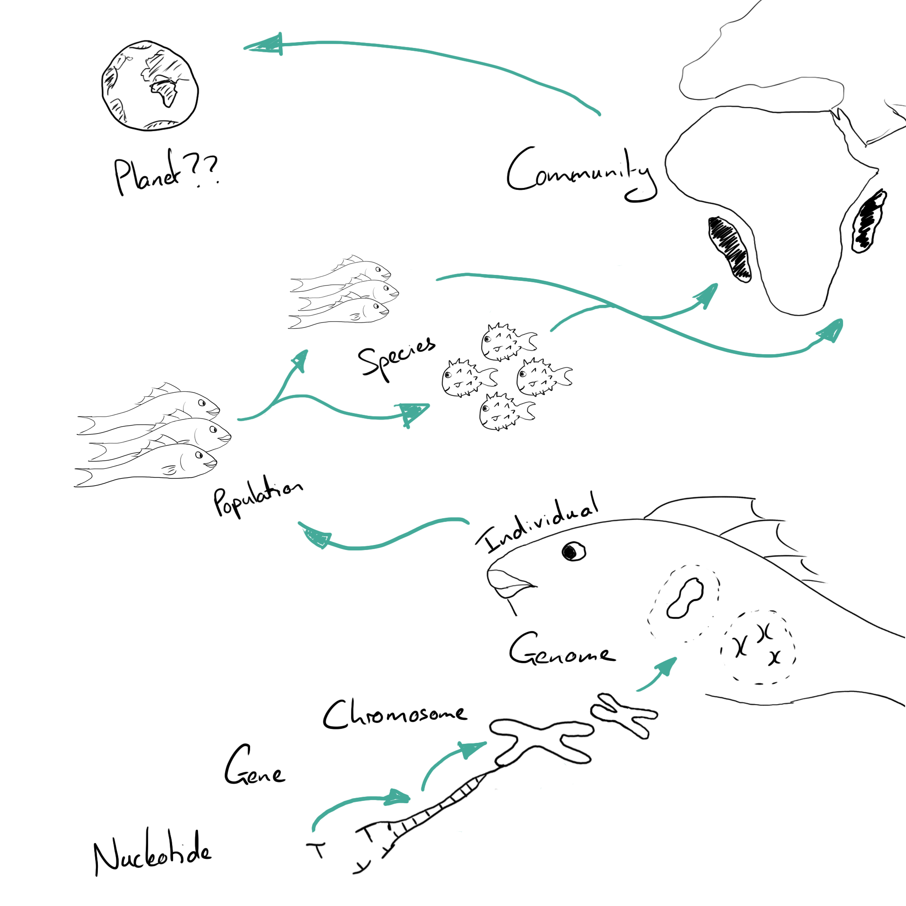
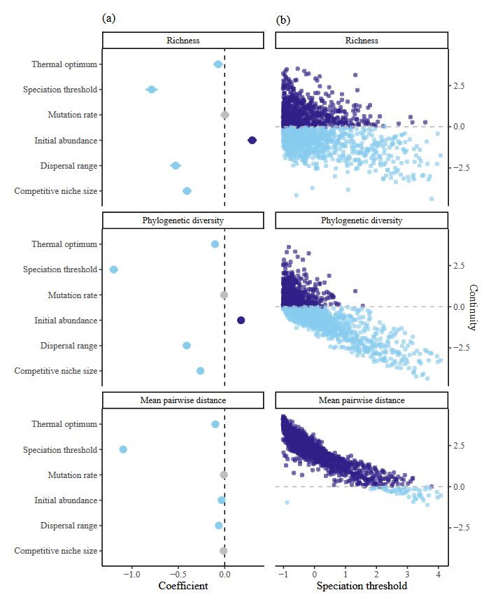
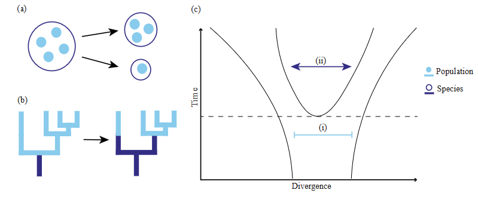

::: content-bubble
## Tropical Fishes and Climate Change

The global climate is changing, and it remains unclear as to how species will respond to their changing environment. Will they:

- Move?
- Adapt?
- Die?

We explored potential scenarios up until 2100 under the CMIP6 RCP8.5 climate projection, where species undergo varying levels of:

- local adaptation,
- dispersal,
- and gene flow;

to gain a better understanding of how they might adapt to the changing environment, track suitable conditions, do both, or fail to do either.

All responses are possible, depending on the characteristics of each species. By exploring these hypotheticals, we improve our understanding of, and methods for, modelling global biodiveristy responses to climate change.

Read the full story:

Keggin, T., *et al.* (2026). [Unexpected global biodiversity responses to climate change arise from complex adaptation, seascape, and dispersal dynamics](https://doi.org/10.64898/2026.03.03.707980). (p. 2026.03.03.707980). bioRxiv.

### The Team

Thomas Keggin\
Alexander Skeels\
Oskar Hagen\
Carlos Melián\
Conor Waldock

### Glossary

***Local adaptation***: the complex phenomenon where species change to become more suited to (in this case) their environment.

***Dispersal***: the movement of species across their environment.

***Gene flow**:* the exchange of genetic material between populations.
:::

::: content-bubble
## The Emergence of Biodiveristy

Global biodiversity patterns are weird, wonderful, and complex - emerging from the seemingly infinite component parts of every biological being on Earth.

Understanding how this happens is a daunting task! But something we must tackle if we are to sustainably co-exist on this planet.

A step along the path from small to big is how patterns of species diversity (the number of species and their evolutionary richness) are created from the actions of individuals and populations living their lives within them.

We tackled a small part of the puzzle by simulating the actions of populations across 200 million years of evolutionary history in warm, shallow water marine fishes.

We generated expectations for how patterns of species diversity might form through the movement, divergence, and speciation of fish through epic shifts in tectonic plates and global climate.

We found that the inconsistent relationship observed between the diversity within species and the diversity between them is should be, at least in part, explainable by the measure of diversity, how fish move around through time, and the genetic architecture underlying their propensity to speciate.

If you find that convoluted - don't worry, you're not alone! What a brain melter!

Read the full story:

Keggin, T., *et al.* (2023). [Diversity across organisational scale emerges through dispersal ability and speciation dynamics in tropical fish.](https://doi.org/10.1186/s12915-023-01771-3) BMC Biology, 21(1), 282.

### The Team

Thomas Keggin\
Conor Waldock\
Alexander Skeels\
Oskar Hagen\
Camille Albouy\
Stephanie Manel\
Loïc Pellissier

### Glossary

***Diversity***: variation in how many, how different, or how regular biological entities are. There are many ways to measure it! Commonly, the number of species, or species richness.

***Genetic architecture***: how DNA is stored and used within a creature. This is extremely variable across the tree of life and has huge impacts on how living things have survived and changed through the history of life.

***Speciation***: the complex phenomenon where some individuals within a species are no longer able to successfully reproduce with the rest, forming a their own isolated group, or species.
:::